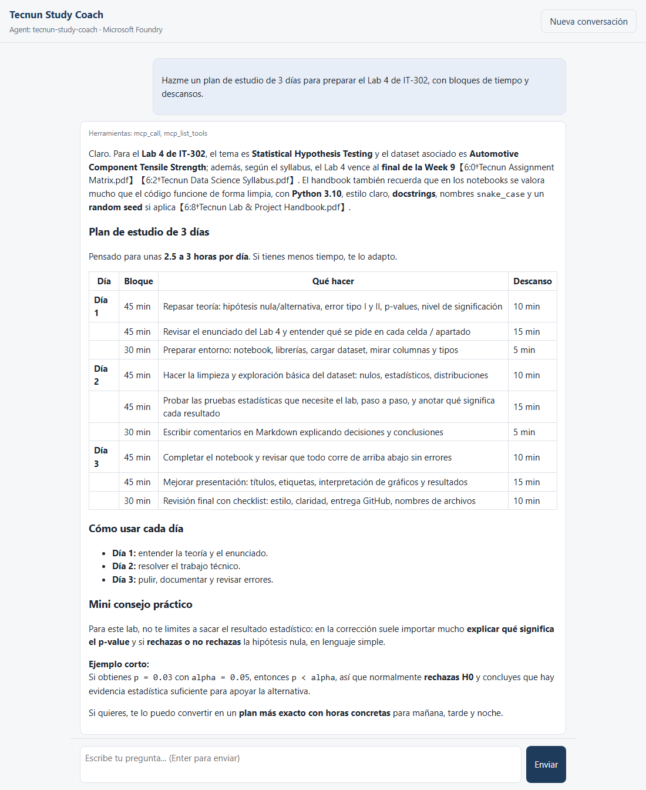
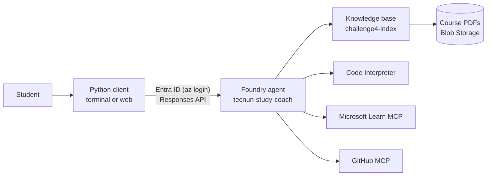
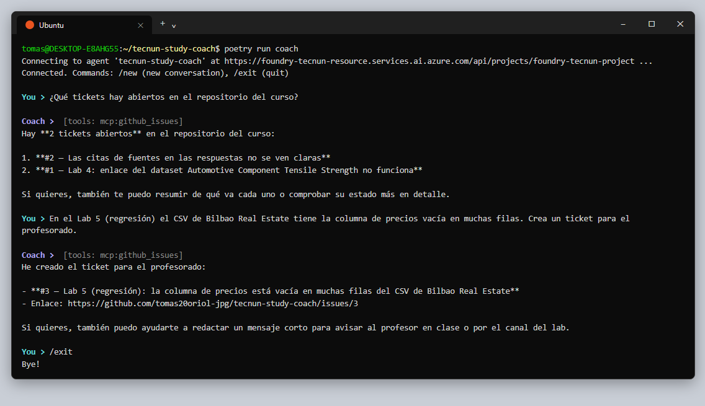

# Tecnun Study Coach

A study assistant for the course IT-302 Introduction to Data Science, built as an agent in Microsoft Foundry. Students ask about the syllabus, lab deadlines or grading and get answers taken from the course documents, not from the model's general knowledge. The agent also works out grades and study plans, looks up official documentation, and opens a GitHub issue when a student reports a problem with a lab.

I built it for a Microsoft Foundry challenge at Tecnun (Universidad de Navarra). The course documents are sample PDFs generated for the challenge.



## What the agent can do

The agent runs on `gpt-5.4-mini` and has four tools:

| Tool | Used for |
|---|---|
| **Course knowledge base** (Azure AI Search) | Questions about the course: teaching staff, deadlines, grading, lab rules. Answers cite the PDF they come from. |
| **Code Interpreter** | Every calculation, such as the average a student needs in the remaining labs. The instructions forbid doing arithmetic "in its head". |
| **Microsoft Learn MCP** | Technical questions about Python, Azure, VS Code or Power BI, with a link to the official page. |
| **GitHub MCP** | Course tickets in this repository: it searches for duplicates, then opens an issue with a title, description and the affected lab. |

It will not hand over full solutions to graded labs. It gives hints and asks what the student has tried instead.

## How it works



The agent lives in Foundry. This repository is the client: it signs in with `DefaultAzureCredential`, opens a conversation and sends each message to the agent through the Responses API. When you quit, the conversation is deleted so no chat history is kept.



## Run it yourself

**You need**

- An account with access to the Foundry project `foundry-tecnun-project` (the students and teachers of the course have it).
- [Azure CLI](https://learn.microsoft.com/cli/azure/install-azure-cli), Python 3.10 or newer and [Poetry](https://python-poetry.org/docs/#installation).

**Steps**

```bash
git clone https://github.com/tomas20oriol-jpg/tecnun-study-coach.git
cd tecnun-study-coach
poetry install
az login                 # sign in with your course account
```

Then pick an interface:

```bash
poetry run coach         # chat in the terminal (/new = new conversation, /exit = quit)
poetry run coach-web     # web chat; opens http://127.0.0.1:5000 in your browser
poetry run coach-test    # one question per tool to check everything works
```

The web chat runs on port 5000. To use another one: `PORT=8080 poetry run coach-web`. Add `--no-browser` if you don't want it to open the browser.

Each person runs the client on their own machine with their own Azure sign-in, so nobody shares credentials. You don't need a GitHub token: the agent reaches GitHub through a connection stored in the Foundry project.

## Project structure

```
src/tecnun_coach/
├── agent.py        # authentication and conversation with the agent
├── cli.py          # terminal chat
├── web.py          # Flask web chat
├── smoke_test.py   # end-to-end check, one question per tool
└── show_agent.py   # prints the agent's current model, tools and instructions
```

## Design notes

- **Search through a knowledge base, not the index directly.** Connecting the agent straight to the search index failed: the agent's own identity had no read role on the search service, and my account can't assign roles. The knowledge base built on the same index uses the project's identity, which already had access.
- **Least privilege for GitHub.** The Foundry project is shared with other students, so the GitHub token stored there can only read and write issues in this one repository. It can't touch code or any other repo.
- **A test script that caught a real bug.** `coach-test` showed the agent sometimes skipped Code Interpreter and got simple averages wrong. Making the instructions stricter fixed it, and the script now checks it after every change.

## Limitations

- It only works for accounts with access to the course's Foundry project.
- Every ticket appears under the repository owner's account, because the agent uses a single token. A GitHub App would let tickets come from a bot instead.
- The answers are only as good as the three sample documents in the index.
